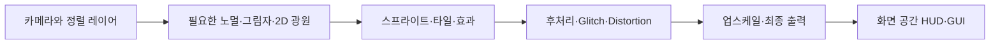

# 세피리아 렌더링: 새 분석과 개발 방향

2026-10-14 현재 설치본을 REA와 직렬화 에셋 분석으로 조사하고, 2026-10-15 비교 실험 모드 1.0.0을 구현했다. 예전 세피리아 문서·코드·커밋은 분석 근거로 사용하지 않았다. 아래의 구조 분석과 실험 후보는 성능 개선이 입증됐다는 뜻이 아니다. 공식 모드 진입점은 [sephiria.md](sephiria.md)에 있다.

## 현재 구현과 F10 사용법 (2026-10-15)

모드 위치는 게임의 `AddOns/LXIUM_sephiria/`다. 공식 HorayMod 로더로 읽으며 BepInEx는 필요 없다. 기존 Harmony를 먼저 재사용하고, 필요한 경우 패키지의 Harmony와 동봉한 라이선스를 사용한다. 설정은 첫 로드 시 이 폴더의 `config.json`에 생성된다. 게임을 종료한 상태에서 `Options`를 변경하고 다시 실행한다.

게임 장면에서 **F10**을 누르면 다음 구간을 순서대로 비교한다. 다시 F10을 누르면 취소한다.

| 번호 | 구간 |
|---|---|
| 1 | 일반 렌더링 |
| 2 | 광원 해상도 분리만 |
| 3 | 효과가 없는 전체 화면 패스 생략만 |
| 4 | 정적 빛 GPU 캐시만 |
| 5 | Unity 호환 dynamic batching만 |
| 6 | 지원 가능한 세계 레이어 업스케일링, 선명화 없음 |
| 7 | 같은 세계 업스케일링 + 전용 선명화 셰이더 |
| 8 | 모든 실험 기능 |
| 9 | 사용자가 저장한 Options 조합 |
| 10 | 일반 렌더링 재측정 |

한 구간은 `SectionSeconds` 기본 **12초**, 범위 10~15초다. 처음 2초는 안정화하고 나머지 시간을 측정한다. 전체는 약 2분이며, 구간 사이의 화면 저장 시간은 측정에서 제외한다. 비교 중 VSync와 FPS 제한을 잠시 해제하고 완료·취소·실패 시 복원한다. 씬·카메라·화면 크기·품질 수준이 바뀌거나 포커스를 잃으면 비교를 중단한다. 게임을 강제 종료한 경우에는 실행 중 복원 코드를 보장할 수 없지만 저장된 Options는 바꾸지 않는다.

결과는 구간마다 `config.json`의 **LastComparison**에 기록한다. 완료/중단 시 `comparisons/<UTC시각>/results.json`에도 저장하며 스크린샷을 같은 폴더에 남긴다. `Screenshots=false`로 화면 저장을 끌 수 있다. 설정 저장은 임시 파일을 거쳐 교체하며 이전 파일은 `config.json.bak`으로 보존한다. 잘못된 설정 파일도 백업 없이 덮어쓰지 않는다.

기록 항목은 평균 FPS, 느린 1%/0.1% 프레임의 평균에 따른 low FPS, 빠른 1%의 high FPS, 최소·최대·평균·p50/p95/p99 프레임 시간, CPU main/render와 GPU 시간, 드로우 호출·배치·삼각형·GC 할당/수집이다. 구간 시작·끝의 스프라이트/활성 광원 수와 카메라 줌도 남겨 장면 변화 여부를 확인한다. 이 개체 수는 동시에 보이는 수와는 다르다. 지원되지 않는 카운터는 0으로 꾸미지 않고 `null`로 남긴다. 마지막 일반 구간과 첫 일반 구간의 차이도 기록해 발열·장면 변화 영향을 확인한다.

켜진 설정과 함께 **LightHits/Misses/Fallbacks, WorldScaled/Native, PassSkipped**를 저장한다. `WorldScaled=0`이면 세계 축소 효과를 측정했다고 해석하면 안 된다. `SpriteBatch`는 Unity의 실제 호환성 판단을 사용하므로 켜도 SRP 셰이더의 드로우 호출이 줄지 않을 수 있다.

현재 기능은 다음 범위에서 동작한다.

- **광원 분리:** 소유한 URP/Renderer2D 복제본의 2D 광원 배율만 조절한다. 기본 0.5이며 세계·UI 버퍼는 원래 크기다.
- **불필요한 패스:** 조사한 Glitch/Distortion의 정확한 효과 0 상태만 후보로 삼는다. 두 셰이더는 알파를 1로 출력하므로 알파 없는 출력 형식·원래 뷰포트 등 조건을 만족하지 않으면 생략하지 않는다. 연출 값은 계속 게임의 원래 재질에서 읽는다.
- **정적 빛 캐시:** 두 프레임 연속 같은 광원 배치만 GPU 텍스처에 복사하고 재사용한다. 카메라·빛·색·레이어·형식 변화는 즉시 무효화한다. 쿠키·노멀·볼륨·그림자 또는 알 수 없는 셰이더는 원래 렌더를 사용한다. 최대 16개 배치/64 MiB다.
- **호환 배치:** 복제한 URP에서 native dynamic batching을 켜는 비교다. 투명 정렬과 재질 호환성은 Unity가 유지한다. 개체의 애니메이션·판정을 멈추지 않는다.
- **세계 업스케일링:** 전체 카메라를 축소하는 대신, 호환되는 정렬 레이어 구간만 저해상도 버퍼에 그린 뒤 같은 위치에서 원래 해상도 버퍼에 합성한다. UI/글자·마스크·특수 재질·파티클·볼륨 효과가 섞인 구간은 원래 해상도다. 다른 구간에 검증되지 않은 깊이 기록자가 있어도 축소하지 않는다. 기본 배율 0.75다.
- **전용 셰이더:** 직접 작성한 HLSL로 premultiplied 알파 합성과 적응형 선명화를 수행한다. 현재 **Direct3D 11 전용**이며, 다른 API나 셰이더 로드 실패에서는 세계 축소를 적용하지 않는다. 반투명 경계의 알파와 HDR 색 범위를 보존하도록 구성했다.

모든 실험 스위치는 기본 켜져 있지만 위 호환성 조건을 통과한 작업에만 적용된다. 효과 없는 후보 탐색과 정확한 캐시 비교 자체에도 CPU/GC 비용이 있으므로, F10 결과를 보고 사용할 Options를 결정해야 한다. 자동으로 가장 높은 평균 FPS 조합을 선택하거나 세이브·전투 속도·적 수를 변경하지 않는다.

빌드/패키지/순수 로직 검사와 저작 셰이더 바이트·바인딩 검사는 통과했다. 모드를 언로드 후 다시 로드할 때 패치 설치 상태도 초기화하도록 수정하고 검사했다. 화면 없는 실행은 게임 자체 초기화 오류와 장면 진입 대기로 끝나 실제 모드 로드·F10·GPU 출력 검증을 완료하지 못했다. 현재 FPS 향상 수치는 없다.

## 우선 결론

세피리아에 맞는 첫 방향은 **광원·장식 효과의 처리 해상도와 갱신 비용을 세계·글자에서 분리하는 것**이다. 세계 전체를 무조건 흐리게 만드는 방식보다 먼저, 100% 해상도로 처리하는 2D 광원과 전체 화면 효과의 필요 비용을 확인한다. 이후 필요하면 세계 업스케일링과 자체 셰이더를 결합한다.

이것은 병목을 확정한 결론이 아니다. GPU 시간, 실제 드로우 호출, 모드가 추가한 개체 수는 아직 측정하지 않았다. 120 FPS 목표는 약 8.33 ms의 프레임 예산이며, UHD나 Iris Xe라는 이름만으로 달성을 보장할 수 없다.

## 실제 렌더 경로

Unity 버전은 `6000.3.21f1`, 직렬화된 기본 품질 설정은 URP의 `Renderer2D`를 선택한다. 게임에 포함된 렌더러 코드에서 다음 순서를 확인했다. 실제 패스 실행은 카메라와 장면 조건에 따라 달라진다.

| 항목 | 현재 저장된 값 | 의미 |
|---|---|---|
| 세계 Render Scale | 1.0 | 세계 버퍼 100% |
| Light Render Texture Scale | 1.0 | 2D 광원 버퍼도 100% |
| HDR | 켜짐 | 발광·색 범위를 유지해야 함 |
| MSAA | 1 sample | 이미 비활성; 이것을 꺼서 이득을 얻는 상황이 아님 |
| SRP Batcher | 켜짐 | 이미 존재하는 최적화 |
| Dynamic Batching | 꺼짐 | 켜면 빠르다고 단정하지 않음 |
| Depth/Stencil | 켜짐 | UI/스프라이트 마스크를 확인하고 유지 |
| Camera Sorting Layer Texture | 꺼짐 | 이 복사 경로가 현재 비용이라고 단정하지 않음 |

빛 혼합 방식은 네 종류가 설정돼 있지만, 조사한 953개의 패키지 내 Light2D 기록은 모두 첫 혼합 방식을 사용한다. 이 수는 한 화면의 광원 수가 아니다. 이 기록들에는 노멀 맵 사용이 없었다. 모드가 만든 광원이나 런타임 변경은 별도 확인해야 한다.

## 캐릭터·그림자·효과

캐릭터 몸체는 `SpriteRenderer`와 `SortingGroup`, `Animator2D_Basic` 계열을 사용한다. Y 방향 투명 정렬과 높이에 따른 레이어 변경이 있어 그리는 순서가 외형과 전투 가독성에 중요하다.

애니메이션 프레임 변경에는 스프라이트뿐 아니라 이벤트와 소리가 연결돼 있다. 화면 밖이라고 캐릭터의 전체 애니메이션이나 GameObject를 멈추면 판정·소리·풀 반환이 달라질 수 있다. 줄일 대상은 검증한 시각 출력과 반복된 값 쓰기이며 게임 동작 자체가 아니다.

`CellBasedCulling`은 이미 간단한 애니메이션의 화면 밖 업데이트를 줄인다. 다만 이름과 달리 조사한 코드는 활성 애니메이터 목록 전체를 매 프레임 복사·순회한다. 공간 구역별 후보 수집으로 개선할 여지는 있지만 실제 개체 수와 CPU 비용부터 측정한다.

`SpriteFx`, `ParticleFx`, 피해 숫자에는 기존 풀이 있다. 새 풀을 다시 만드는 것만으로 해결되는 구조가 아니다. ParticleFx는 Unity ParticleSystem, SpriteFx는 스프라이트 애니메이션·광원·부모 추적을 조합한다. 보스 공격 경고에는 VFX 셰이더도 있어 일반 장식 파티클과 구분해야 한다.

바닥의 `Shadow`는 캐릭터 높이에 맞춰 알파를 바꾸는 그림자 스프라이트다. Light2D의 그림자 시스템과 다른 경로다. 3D 그림자 해상도만 낮춰 두 경로가 모두 빨라진다고 설명하면 안 된다.

## GUI·TEXT·아티팩트

HUD, DynamicHUD, 패널, 시스템 표시 등은 화면 공간 Overlay Canvas다. 세계를 축소해도 이 경로는 원래 출력 해상도를 유지할 수 있다.

그러나 피해 숫자는 `TextMeshProUGUI`이면서 World Canvas에 들어간다. World·Alt World·Ground World는 월드 공간 Canvas로 메인 카메라가 그린다. 모두 UI 오브젝트 레이어를 사용하지만 정렬 규칙은 다르다. UI 레이어 하나만 나중에 그리면 Ground World가 원래 가려져야 하는 물체 위로 올라오는 문제가 생길 수 있다.

아티팩트/아이템 UI는 `Image`, 보조 아이콘, 희귀도 배경, 툴팁과 TMP 텍스트의 조합이다. 석판 색각 보정용 재질, HDR 발광 UI, 마스크·스텐실도 존재한다. 저해상도 처리에서 글자만 빼는 것으로 끝나지 않고, 아이콘과 접근성 표시도 유지해야 한다.

## 광원·날씨·후처리

`GameCamera`는 층 이동 시 배경, 시차 스크롤, 일광, 비·안개·불꽃, 후처리 프로필을 바꾼다. `DayCycle`은 시간·날씨·연출에 따라 전역 Light2D와 배경색을 갱신한다. 고정된 빛을 한 번 구워서 모든 장면에 쓰는 방식은 맞지 않는다.

게임 장면에 연결된 Bloom은 강도 약 1.8이다. 기본 프로필의 강도 0만 보고 Bloom이 꺼져 있다고 판단하면 안 된다. HDR 발광과 원래 연출을 보존하며 더 작은 버퍼나 필요한 영역만 처리할 수 있는지 검토한다.

Glitch와 Distortion 전체 화면 기능은 둘 다 활성화되어 있고 색상 버퍼를 가져오도록 설정돼 있다. 저장된 `_Intensity`는 0이지만 다른 속성과 게임 코드가 출력을 바꿀 수 있다. 실제로 효과가 없는 상태를 증명한 뒤에만 복사·패스를 생략하는 후보로 삼는다. 연출 시 다시 켜지는 조건을 함께 확인해야 한다.

## 우리 렌더러의 개발 후보

| 후보 | 세피리아에 맞춘 방식 | 채택 전에 확인할 것 |
|---|---|---|
| 광원 해상도 분리 | 세계·UI는 원래 해상도, 광원만 1.0/0.75/0.5 비교 | 작은 광원·경계·겹침, 실제 GPU 시간 |
| 세계 업스케일링 | 월드 UI를 먼저 보호한 뒤 세계/효과 버퍼 축소; 기존 FSR1을 기준으로 비교 | 픽셀 아트, 카메라 줌, 후처리, 월드 글자 정렬 |
| 정적 빛·배경 재사용 | 고정된 기여만 캐시하고 동적 광원과 시간/날씨 변화는 별도 반영 | 레이어별 빛 대상, 카메라 이동, 쿠키·광원 순서, 캐시 무효화 |
| 장식 스프라이트 일괄 출력 | 같은 텍스처·재질이며 원래 정렬에서 연속한 장식만 묶음 | 공격 경고·그림자·알파 순서·새 스킨 호환 |
| 불필요한 GPU 패스 생략 | 출력이 동일한 효과 없는 상태에서만 실행 제외 | 연출 중 활성화, 이미지 비교, 캡처한 실제 패스 |
| CPU 작업 분리 | 위치·범위를 복사한 자료에서 시각 후보 계산만 병렬화 | 복사·동기화 비용; Unity 객체와 판정은 원래 스레드 유지 |

광원 해상도를 가로·세로 각각 절반으로 줄이면 그 버퍼의 픽셀 수는 약 1/4이다. 이는 전체 GPU 시간이나 FPS가 4배 좋아진다는 뜻이 아니다.

더 발전된 자체 셰이더 후보는 단순한 장식용 SpriteLit, 낮은 해상도의 광원 합성, 발광/날씨 효과 합성이다. 원래 마스크·HDR·안개·발광·피격 표시와 정렬을 지원하고, 모드의 알 수 없는 재질은 원래 경로로 처리한다. 셰이더는 렌더 경로·버퍼·배치 방식과 함께 개발해야 한다.

## 제안된 기술의 적용 판단

- **Spatial Resolution:** 적합한 후보다. 먼저 광원부터 분리하고, 세계 축소는 월드 UI를 보호한 다음 실험한다. 선명화는 잃은 세부를 복구하는 마법이 아니며 픽셀 아트의 번짐과 테두리를 비교한다.
- **Temporal Frame Reprojection:** 첫 구현 대상은 아니다. 이동·가림 해제·신규 파티클·스프라이트 교체·카메라 흔들림과 출력 타이밍을 처리해야 한다. 프레임 재사용, 시간적 업스케일링, 실제 중간 프레임 생성은 서로 다르다. 고정된 20~30 FPS 이득은 예상하지 않는다.
- **Opaque Ice와 같은 불투명화:** 캐릭터·발광·안개에는 그대로 적용할 수 없다. 알파와 Y 정렬을 깨뜨릴 수 있다. 완전히 불투명한 지형을 확인한 경우에만 별도로 평가한다.
- **Render Fast:** 이미 켜진 SRP Batcher를 기준으로 삼는다. 임의의 전체 스프라이트 재정렬 대신, 연속한 호환 장식의 제출·값 갱신 비용을 줄인다.
- **Async:** Unity 객체 조작·전투·Mirror 네트워크를 병렬로 옮기지 않는다. 순수 자료 계산을 분리한 경우에만 실제 이득을 비교한다.

## 첫 구현과 검증 순서

1. 공식 로더로 동작하는 진단 모드에서 실제 카메라·품질 자산·GPU API·활성 모드와 CPU/GPU 프레임 시간을 기록한다. 모드 구성과 게임 옵션은 유지한다.
2. 세계와 UI를 바꾸지 않고 광원 해상도만 비교한다. 공유 자산 원본을 덮어쓰지 않고 종료 시 자원과 설정을 정리한다.
3. Glitch/Distortion의 효과 없는 상태를 검증하고, 그 상태에서만 패스 생략을 비교한다.
4. CPU 비용이 크면 기존 culling/값 갱신 경로를 개선한다. GPU 비용이 크면 월드 UI를 보호한 세계 버퍼와 셰이더 실험으로 진행한다.
5. 성능과 화질이 모두 확인된 기능만 패키지에 채택한다. 프레임 생성은 별도 후속 실험으로 취급한다.

측정 장면에는 타이틀의 반사, 일반 전투, 적·피해 숫자가 많은 전투, 비/눈/안개와 시간 변화, 보스 공격 경고, 아티팩트 인벤토리/툴팁, 협동·사용자 스킨을 포함한다. 평균 FPS뿐 아니라 CPU/GPU 시간, p95/p99 프레임 시간, GC 할당, 드로우/패스 수와 화면 비교를 남긴다. VSync·제한 FPS·줌·모드의 생성 배율·해상도를 기록하고 비교 중 고정한다.

## 근거와 남은 범위

REA는 본체와 설치된 URP 렌더러의 관리 코드·호출·메서드 토큰을 확인했다. Unity 직렬화 에셋 전용 REA 도구가 없어 에셋은 UnityPy와 관리 타입 기반 TypeTree 생성기로 보완했다. 파서의 포인터·바이트 소비 검사를 통과한 핵심 설정만 사용했다. 정확한 자산 ID, 해시, 미해석 항목은 [AI용 문서](../ai/sephiria-render.md)에 있다.

Unity 공식 문서도 [세계 Render Scale과 UI 해상도](https://docs.unity3d.com/6000.3/Documentation/Manual/urp/universalrp-asset.html), [별도 2D 광원 버퍼 설정](https://docs.unity3d.com/6000.3/Documentation/Manual/urp/2DRendererData-overview.html)을 설명한다. 실제 설치본의 카메라/Canvas와 코드를 함께 확인해 적용 범위를 판단했다.

아직 실제 GPU 프레임 캡처, Unity 네이티브 렌더 스레드/드라이버 병목, 런타임 모드 호환성, FPS 개선은 확인하지 않았다. 전체 화면 원본 셰이더의 효과 0 조건과 전용 셰이더의 바인딩은 D3D 바이트코드로 추가 확인했다. 위의 후보·검증 계획과 현재 실험 구현을 구분한다.
